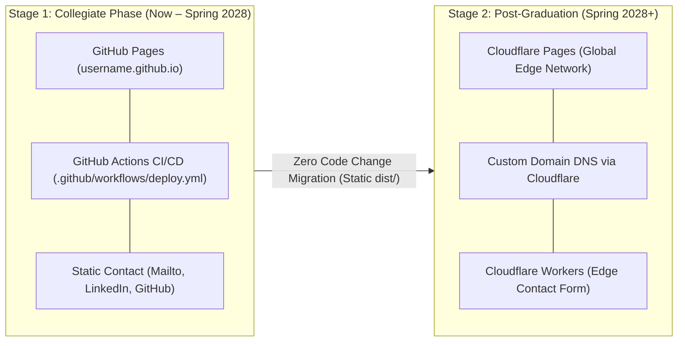
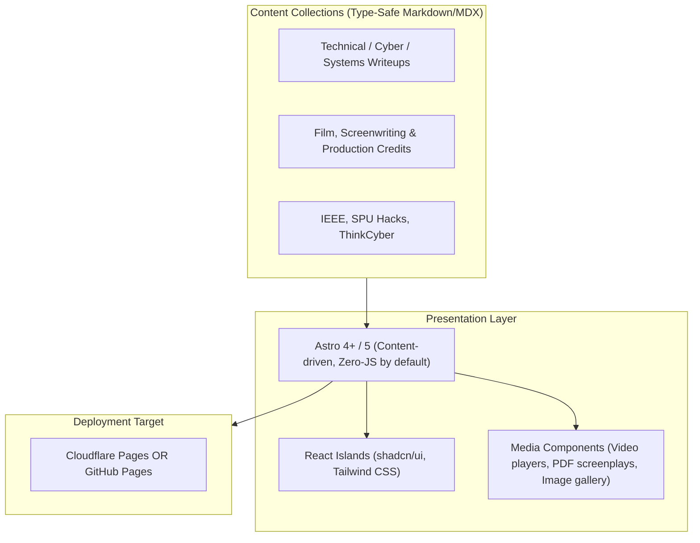

# Implementation Plan: Portfolio Website Architecture & Platform Selection

## Goal Description
Dominic needs a modern, high-performance portfolio website to showcase two distinct but complementary domains:
1. **Technical Systems & Security**: Go/Rust tools, cybersecurity research (MITRE ATT&CK, PICERL), networking projects, ML evaluations, and SPU Hacks / IEEE leadership.
2. **Creative Arts & Film Production**: Short films (*The Zed Word*, *An Original Idea*), screenwriting, production coordination, video/ADR work, and visual arts.

This plan evaluates hosting options beyond **GitHub Pages**, recommends optimal site architecture frameworks, and outlines a phased execution plan within a dedicated workspace subfolder (`./portfolio/`).

---

## 1. Two-Stage Hosting Roadmap (Collegiate -> Post-Grad)

### Strategy: Zero-Lock-In Static Architecture
1. **Stage 1 (Now – Spring 2028 Graduation)**:
   - **Host**: **GitHub Pages**.
   - **Delivery**: Automated continuous deployment via standard GitHub Actions (`deploy.yml`).
   - **URL**: `username.github.io` (or custom domain if configured).
   - **Contact & Forms**: Direct email (`mailto:`), LinkedIn, and GitHub links. Keeps the site 100% static with zero backend dependencies or third-party tracking.
2. **Stage 2 (Spring 2028 Post-Graduation Migration)**:
   - **Target**: **Cloudflare Pages**.
   - **Migration Effort**: Less than 5 minutes. Because Astro generates pristine static output (`dist/`), switching hosts requires only connecting the GitHub repo to Cloudflare Pages and pointing DNS.
   - **Upgrades Unlocked Post-Grad**: Add Cloudflare Worker edge function for a direct contact form, deploy edge middleware, and enable server-side analytics.

---

## 2. Recommended Framework Stack: Astro + Tailwind CSS + TypeScript

To balance fast content editing (Markdown/MDX for writeups) with high-end interactive UI (shadcn/ui / Tailwind) and media embeds (video, scripts, gallery):

### Why Astro + Tailwind + TypeScript:
- **Dual-Domain Content Collections**: Type-safe frontmatter schemas for both technical specs (repo, live demo, language, MITRE tags) and film specs (role, run time, festival laurels, trailer embed, logline).
- **Extreme Speed (Lighthouse 100)**: Renders static HTML by default, only hydrates interactive JavaScript components when visible (island architecture).
- **Host Agnostic**: Builds pure static files that deploy identically to **Cloudflare Pages**, **GitHub Pages**, **Vercel**, or **Netlify** with zero lock-in.

---

## 3. Visual Design System: Chromatic Cyberpunk & DataTerm HUD

Inspired by the diegetic terminal aesthetic of `dataterm.ca` upgraded to a vibrant, multi-color cyberpunk palette (*Cyberpunk 2077*, *Edgerunners*, *Ghost in the Shell*):

### 3.1 The 5-Color Chromatic Palette
- **Base / Void**: Obsidian Carbon (`#0b0d13`) with subtle circuit/grid lines and gunmetal panels (`#12151f`).
- **Electric Cyan (`#00f0ff`)**: Systems programming, cybersecurity research, networking protocols, technical tags.
- **Hot Magenta (`#ff0055` / `#f72585`)**: Film production, directing, screenwriting, creative media highlights.
- **High-Voltage Yellow (`#fcee0a`)**: Leadership badges (SPU Hacks, IEEE Region 6), status alerts, caution marks.
- **Acid Green (`#00ff66`)**: Live indicators (`[SYS: ONLINE]`, active commit ping, operational uptime).

### 3.2 Diegetic HUD Components & Layout
- **Top Header Status Bar**:
  - `DOMINIC HATCHER-THOMASSEN // ID: DHT-2028`
  - Real-time UTC clock + `[SYS: ONLINE] 🟢` + `[CLEARANCE: FELLOW @ SPU]`
  - `[CRT FX: ON/OFF]` toggle button for optional retro scanline atmospheric mode.
- **Terminal Filter Directory Tabs**:
  - `[/00_ALL_ARCHIVES]`
  - `[/01_SYS_ENGINEERING]` (Cyan glow on hover/active)
  - `[/02_MEDIA_ARCHIVES]` (Magenta glow on hover/active)
  - `[/03_LEADERSHIP_OPS]` (Yellow glow on hover/active)
- **Project Dossier Presentation**:
  - **Engineering Cards**: Displayed as **Field Dossiers** (language badge, MITRE tactic tags, live GitHub repo link, interactive architecture preview).
  - **Film Cards**: Displayed as **Production Slates / Reels** (scene/take headers, runtime, festival laurels, embedded video preview, screenplay PDF link).
- **Tactical UI Details**:
  - Chamfered sci-fi angular cuts via CSS `clip-path` rather than standard rounded corners.
  - Bracketed terminal metadata (`[STATUS: VERIFIED]`, `[ROLE: SCRIPT_COORD]`).
  - Dual typography: Monospace (`JetBrains Mono`) for HUD/headers/metadata + Sans-serif (`Space Grotesk` or `Inter`) for long-form case study readability.

---

## Locked-In Decisions & Review Items

> [!IMPORTANT]
> ### Confirmed Architecture:
> 1. **Immediate Host (Collegiate Phase: Now – Spring 2028)**: **GitHub Pages**  
>    - Builds and deploys directly via GitHub Actions to your GitHub Pages repository/environment.
>    - Zero monthly overhead, zero external services needed.
> 2. **Post-Graduation Migration (Spring 2028+)**: **Cloudflare Pages**  
>    - The static build (`dist/`) is kept 100% host-agnostic, ensuring a zero-rewrite migration when graduating.
> 3. **Site Framework**: **Astro + Tailwind CSS + TypeScript**  
>    - Type-safe Markdown/MDX content collections (for both tech writeups and film assets).
>    - Fast static generation suitable for GitHub Pages now and Cloudflare Pages later.
> 4. **Project Isolation**: All codebase files will reside strictly in `./portfolio/`.

---

## Remaining Design Questions

> [!NOTE]
> 1. **Repository Name**: Will this be your primary user site repository (`<username>.github.io` on GitHub) or a project repository (e.g. `github.com/<username>/portfolio` hosted at `<username>.github.io/portfolio`)?
> 2. **Initial Domain**: Do you plan to attach a custom domain (e.g. `dominic.dev`) to GitHub Pages now, or use the default `github.io` address until graduation?

---

## Proposed Changes

All files will be created in an isolated project subfolder: `c:\development\General Workshop[AntiG]\portfolio\`.

### Phase 1: Project Scaffolding
- Initialize the portfolio subfolder `./portfolio/`.
- Setup project framework (Astro + TypeScript + Tailwind CSS).
- Configure `astro.config.mjs` with `site` and `base` paths tailored for GitHub Pages.

### Phase 2: Schema & Content Collections
- Define `src/content/config.ts`:
  - `techProjects` collection: Title, date, tags (Go, Rust, Cyber, Networking), GitHub link, live demo, summary, writeup body.
  - `filmProjects` collection: Title, logline, role (Director, Script Coordinator, PM), laurels, trailer/VOD link, gallery assets.
  - `leadership` collection: SPU Hacks, IEEE Region 6, ThinkCyber fellow, achievements.

### Phase 3: Core Layout & Dual-View UI
- Dual-path or hybrid homepage: Hero introducing Dominic's dual CS & Media identity.
- Filterable showcase allowing visitors to toggle between:
  - *All Work*
  - *Engineering & Cyber*
  - *Film & Narrative*
  - *Leadership & Community*
- Dark mode toggle with system preference detection.

### Phase 4: GitHub Pages CI/CD Workflow
- Create `.github/workflows/deploy.yml` configured to:
  - Check out the repository.
  - Setup Node.js and dependencies.
  - Run build to compile the static Astro site to `dist/`.
  - Deploy to GitHub Pages via official `actions/deploy-pages`.

### Phase 5: Spring 2028 Cloudflare Pages Migration Blueprint
- Document step-by-step instructions in `./portfolio/MIGRATION.md` for seamlessly transferring DNS and hooking the repository to Cloudflare Pages upon graduation.

---

## Verification Plan

### Automated Checks
- `npm run build`: Verify zero build errors, type safety, and clean static page generation.
- `npm audit` / dependency verification.
- Astro check: `npx astro check` (verifies all content collection frontmatters against TypeScript schemas).

### Manual Verification
- Test responsive layout across mobile, tablet, and desktop viewports.
- Verify asset loading (video embeds, film stills, PDF screenplay preview if applicable).
- Run Google Lighthouse audit (target 95+ across Performance, Accessibility, Best Practices, and SEO).
